# DOPE (Complex, 1995) - effects, shared 3D engine, and what is exact

*DOPE* by **Complex** (code jmagic, jugi, reward), released at The Gathering 1995. `DOPE.EXE` is 584,133 bytes: a DOS MZ header followed by eight
RNC ProPack (method 1) blocks (a loader with a Gravis UltraSound replay routine, then seven demo parts), and `DOPE.MOD`, a 28 channel module (957,334 bytes,
8:34 as libopenmpt counts it). The page plays 7:53 of picture, then loops. Everything below was read out of the demo's own blocks; "block N +0xXXXX" is a
file offset in the unpacked block N (the code's own addresses are that minus 0x100).

## 0. At a glance

| part | length | on screen | trick |
|------|-------:|-----------|-------|
| 1 | 39 s | the COMPLEX logo | a 320 pixel window onto a 1024 pixel picture, palette made from two ramps |
| 2 | 117 s | credits, "phong BLUR motion" | polygons on a band buffer, the screen is a recursive blur of it |
| 3 | 52 s | "7800 PHONG polys" | per pixel lookup of the interpolated normal |
| 4 | 106 s | "FIRE clouds", "FRACTAL scape", checker floor | two layers in one byte, a palette that is a 16 x 16 mix table |
| 5 | 65 s | "phong ENV mapping", "BUMP glow" | the lighting table is rebuilt every tick |
| 6 | 58 s | "SHADOW volume", "material MORPH", "METAL shading" | lights that follow the camera, palette cross fade per tick |
| 7 | 36 s | "multiple LIGHT sources", "1995 WORLD domination" | five blobs added into the lookup picture every frame |

Lengths are the measured ones in `web/data/parts.json` (timer interrupts divided by 70.086 Hz). Parts 2, 3, 5, 6, 7 are one software 3D engine assembled five
times (section 2); part 4 has no polygons at all. The only effect-level asset that is not code is data in the blocks: pictures, palettes, meshes, a
quarter sine, warp fields.

### Display and timing

* **VGA mode 13h, 320x200, 256 colours**, set with `int 10h` and then reprogrammed (part 1 and 2, 3, 6, 7 touch the sequencer; see `docs/RUNTIME.md`). Pixels are
  not square, so the page draws the 320x200 index image in a 4:3 box (README). The 3D projection already builds a 4:3-ish ratio in: x is `X*f/z / 8`, y is
  `3*Y*f/z / 32` (asm write-up, section 12).
* **Every part is driven by its own INT 8 handler**, reprogrammed to about one interrupt per video frame (69 to 70 per second). The handler waits for the start of
  the vertical retrace, re-arms the PIT in one shot mode with a divisor calibrated against the monitor, calls the part's hook, and chains to the BIOS tick only when
  a 16 bit accumulator of PIT counts carries (asm write-up, sections 1 to 3).
* **Parts are overlays.** The loader (block 0) unpacks one part at a time. A part is not self contained: part 1 reads data from the loader's area, parts 4, 5, 6 start
  on the screen the previous part left. The port reproduces the loader's placement with a 1 MB memory image (`web/js/ports/image.js`: block at segment 0xf8b,
  relocated words get `+ segment - 0x10`; the relocation lists are measured).
* **The music is a MOD played by the GUS replay routine**; the page plays it with libopenmpt in an AudioWorklet and uses the number of audio frames rendered as the
  clock. Pause and seek move picture and sound together. The parts do not read the module's position: their timeline is their own timer ticks (script steps),
  so "seek" means restarting a part and fast forwarding its port to that tick.

## 1. Part 1: the logo (a window, two ramps)

No polygons and no per frame drawing. The unpacker (`0xc5c`, asm write-up 6) lays a picture of 195 rows of 1024 pixels into a card memory that part 1 has switched to
planar mode with a 336 plane byte line (CRTC register 0x13 = 0xa8). The screen is then a 320 pixel window moving over it, two register writes from one counter:

```js
// web/js/part1.js
startPixels(counter) { return ((counter >> 4) & 0xffff) << 2; }   // CRTC start address, in pixels
panPixels(counter)   { return ((counter >> 2) & 3) - 1; }         // attribute controller pan: one pixel per 4 counts
frame: out[y*320 + x] = vram[ lineStart(counter) + 1344*y + x ]   // a plain window copy
```

The ISR adds 2 to the counter per tick, so one scroll pixel is two ticks; the part lasts 5376 counts (2688 ticks, 39 s).

The colour change is the other half. 64 colours are rebuilt from two 64 entry ramps through two index tables stored in the block (`tblA` at block +0x5f0,
`tblB` at +0x8f8):

```js
palette(counter) {
  const d = (counter - 0x1f4 - 4) & 0xffff;
  ramp((0x1000 - d) & 0xffff, rampA);   // one ramp fades out ...
  ramp(d, rampB);                       // ... the other fades in
  for (i = 0; i < 192; i++) out[i] = min(63, rampA[tblA[i]] + rampB[tblB[i]]);
}
```

`ramp(steps)` is 8.8 fixed point: slope `steps >> 4` clamped to 0x100, 64 entries `ax >> 8`, and it stops adding once `ax > 0x3f00` (so it saturates at 63 without
a clamp). Cross fading two whole palettes costs 192 table lookups and touches no pixel.

**Exact vs approximated.** This part is *transcoded*, not emulated: the picture strip and both tables are read from `DOPE.EXE` by `web/js/rnc.js`. Against
15 frames captured from the original in DOSBox-X, 11 are byte identical and the other four differ by 8 pixels each (32 of 960,000), all in the last picture row.
The README records that an earlier "the picture differs" conclusion was a units mistake in the port (four pixels per plane byte; the CRTC start counts plane
bytes). The 2 tick palette lag (`PALETTE_LAG = 4` counts) and the 69 Hz tick rate are measured, not derived.

## 2. The shared 3D engine (parts 2, 3, 5, 6, 7)

The five parts draw with one engine, not a library: each block links its own copy, assembled again with small edits (`docs/ENGINE.md`). Two listings of the copies
with the numbers blanked out differ in a handful of lines (part 7's against part 3's in two), which is how the ports were made quickly once part 3 worked.

```
objects   per object record: angles = (own + camera) >> 4, rotation matrix, every vertex rotated, lit, projected; every face culled and keyed
sort      radix sort of the faces by depth key, one bit per pass, two ended partition
draw      polygons back to front: a lookup-table ("phong") fill or a plain texture fill
compose   paste the label, copy the buffer to the card, restore the background
timer     (70 Hz, in the INT 8) moves every object by its speed, slides the label
script    a straight line of "mov [var],imm ... call run" steps, 7 to 153 per part
```

* **Matrix.** One quarter of a sine is stored; the part builds a 2048 entry period from it (mirror, negate, copy, 4 words `lodsw/stosw` loops; same routine as
  part 4's `buildSine`, asm 17). The matrix is nine `imul` / `sar 15` products in 15 bit fixed point. Part 2's copy adds `adc eax,0` after every `sar` (rounds to
  nearest) except one; the other four copies lost them all (asm 20).
* **Vertices.** `x' = X*f/z / 8 + 160`, `y' = 3*Y*f/z / 32 + 100`, rounded by `adc ax,0xa0` / `adc ax,0x64` (asm 12). Two extra values per vertex: `env`, the
  rotated normal's x,y, and `tex`, from the unrotated normal (parts 3, 7) or from the object (2, 5, 6).
* **Faces.** Visible when the 16 bit cross product of two screen edges has the right sign (a flag flips the test for inward facing objects). Keyed by
  `(sum of the three depths) << 16 | slot`. Vertex offsets are multiples of 4, so the low two bits of vertices 1 and 2 are free and carry the face's material (one of
  four).
* **Sort.** An LSD radix sort, one bit per pass, as a stable two ended partition (asm 11): 11 passes from bit 21 in parts 3, 5, 7, 12 in part 6 (bit 20), 14 in part 2
  (bit 18). Room for 1,000 to 2,000 faces: the part's hard limit.
* **Fillers.** *Phong*: two attributes packed as two 16 bit lanes in one register, interpolated across the triangle, pixel = `ds[ row(fs[T]) + U ]`: two lookups per pixel.
  The colour depends on where the interpolated normal points, so the highlights are smooth with about 1,000 triangles. *Texture*: one attribute, the normal's x,y, as
  a position in a 256 x 256 picture. A face uses the texture fill when its material has no lookup map.
* **Edges.** Held as packed screen addresses with 16 fractional bits, the two edges crossed in two registers so that one `add / adc / adc` steps both (asm 10); the
  per polygon gradients are written into the immediates of the inner loop (asm 8, 9).
* **Quirks kept** (asm 18 to 20): `99` is `cwd`, not `cdq`, in the row slope divisions; `shld ebx,ecx,N` with N = 8 (parts 3, 7), 9 (2) or 10 (5, 6); the texture inner loops
  count pixels in `al`.

How the copies differ (`docs/ENGINE.md`; the table there was produced by diffing the listings):

| | part 2 | part 3 | part 5 | part 6 | part 7 |
|---|---|---|---|---|---|
| rotation matrix | rounded (`adc`) | truncated | truncated | truncated | truncated |
| vertex `tex` | from the object | from the normal | from the object | from the object | from the normal |
| sort | bit 18, 14 passes | bit 21, 11 | bit 21, 11 | bit 20, 12 | bit 21, 11 |
| phong `shld` | 9 | 8 | 10 | 10 | 8 |
| row table | fixed | fixed | rebuilt by the timer | rebuilt by the timer | fixed |
| lookup picture | fixed | fixed | fixed | repainted each frame | repainted each frame |

### How a model is stored, and the seven meshes

One segment per mesh: a 16 byte header of word offsets, then vertices (3 x int16 within +-8191), faces (8 bytes: attribute word, three vertex numbers times 4), normals
(3 x int16, all of the same length 27,559) and texture coordinates (2 x int16). The attribute word is 0 in all seven meshes; the material comes from the object record. The scene is a table of
0x3A byte records (mesh segment, hidden flag, focal length, position, velocity, angles, angular speeds, selector, cull flag, vertex offset); the first record is the camera.
The timer interrupt does the moving, the script only sets speeds and positions: that is all the choreography.

| mesh | part | vertices | faces | Euler number | looks like (my reading of the render) |
|------|-----:|---------:|------:|-------------:|-------------|
| `part2_ring` | 2 | 250 | 500 | 0 | a pentagonal slab with a hole |
| `part2_knot` | 2 | 432 | 864 | 0 | a tube bent into a double C (12 sided, 36 steps) |
| `part3_rock` | 3 | 514 | 1024 | 2 | a lumpy sphere |
| `part5_worm` | 5 | 432 | 864 | 0 | a tube folded over itself |
| `part6_open` | 6 | 352 | 671 | 1 | a cat; an open surface |
| `part6_cube` | 6 | 256 | 512 | 0 | two crossed rings (16 sided, 16 steps) |
| `part7_snakes` | 7 | 1446 | 2888 | 2 | an eight armed star, flat |

`V - E + F` tells what they are: 2 a sphere, 0 a torus (a 12 or 16 sided section swept along a closed path, hence 432 = 12 x 36, 256 = 16 x 16), 1 a surface with a
boundary. The tubes of parts 2 and 5 have the same topology and size and a different path. Renders: `docs/EFFECTS.md`, generated by `tools/models.mjs`.

Copies of the existing renders (shaded and wireframe, three views each, from `web/img/models/`):

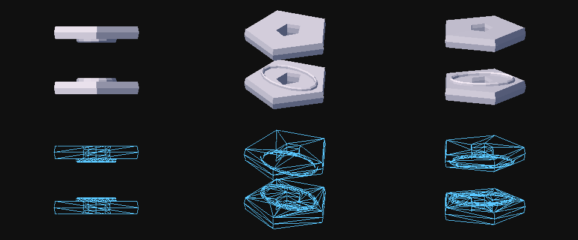
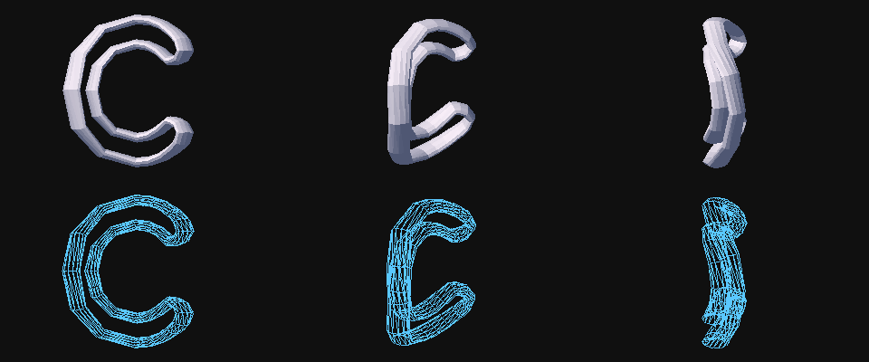
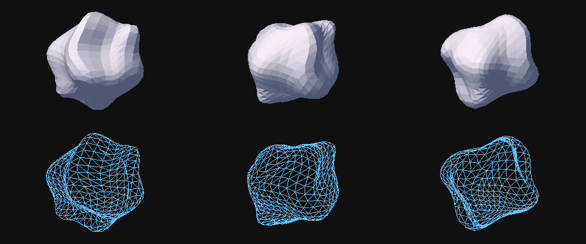
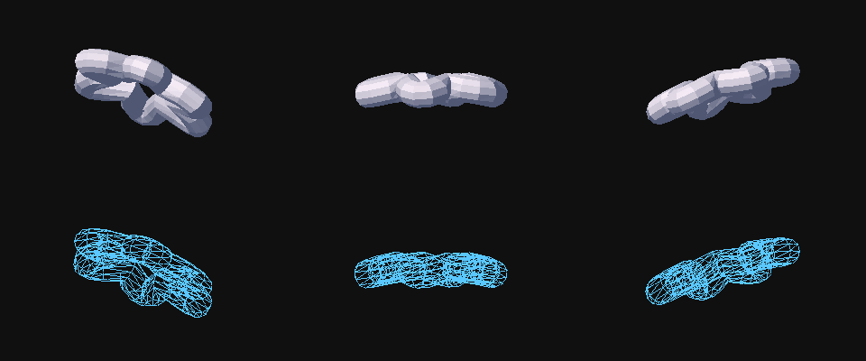
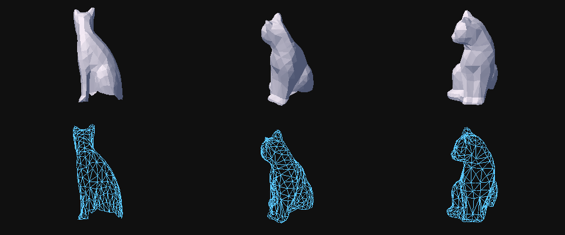
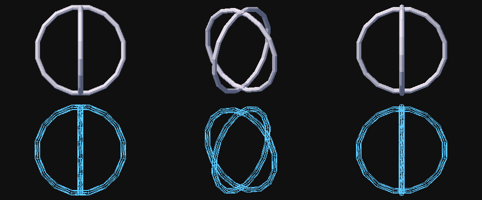
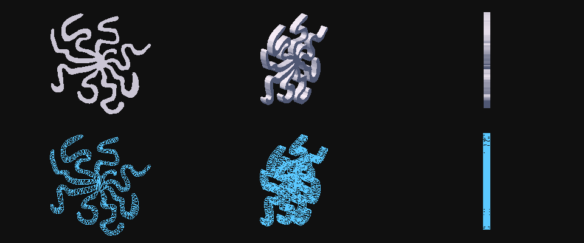

## 3. Part 2: credits and a recursive blur

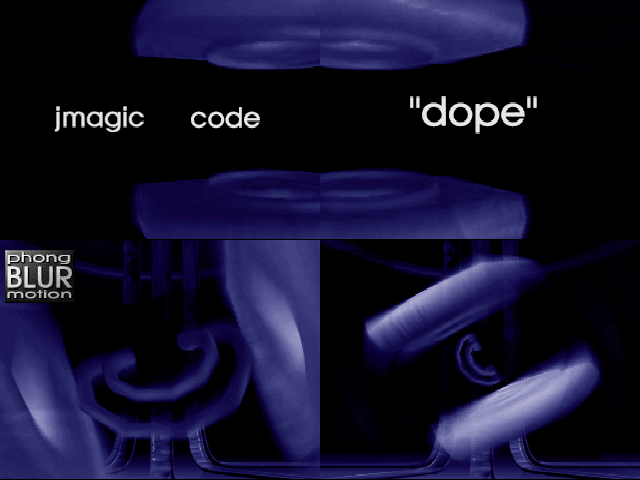

The oldest copy of the engine, and the only part where the engine does not draw on the screen. The polygons go into a **band buffer**; the credit text is not a font but
four pre shaded 320 x 32 pictures loaded one after the other into a strip of the band. Then, for every pixel of the screen buffer:

```js
// web/js/ports/part2.js compose()
for (let i = 0; i < 64000; i++) scr[i] = shade[(scr[i] << 8) | band[i]];
// shade table (0x1a98): 0x80 | ((0x1a0*old + 0x60*band) >> 1) >> 8, i.e. 81% old, 19% new
```

The output is written back into the same buffer, so it is a feedback filter: each frame is 81 % the previous screen and 19 % the new band. Moving shapes leave soft
trails and the text melts in. The table is 64 KB, built three times over (offsets `+0x80`, `-0x8000`, `-0x7f80`) so the high bit that every output carries is ignored by
the next lookup. A script step (`clearshade`) zeroes the upper half of the table, cutting the feedback, and the next frames go dark.

The lighting is a 128 x 128 ramp `(slope*x + (256 - slope)*y) >> 8` that the script re-slopes 118 times: the sheen slides over the surfaces. The second object (the C) is
drawn with the plain texture fill (17,000 of 44,000 polygons over the part), the first with the lookup fill.

The palette: while `[0x193f] == 1` the timer rewrites all 256 DAC entries every tick from a fixed base palette through a 64 entry brightness ramp that reaches the
identity after 64 ticks (a fade in); the part ends by setting all 768 values to 63 (white).

**Exact vs approximated.** Exact: the port is run in lock step against the original's own code for 3,657 frames, comparing every variable, the band and screen buffers,
the shade table, the DAC and the picture (`tests/test_port3_run.mjs --block 2`). The script is decoded from the machine code (153 steps, `tools/scriptdump2.py`), not retyped.

## 4. Part 3: 7800 PHONG polys

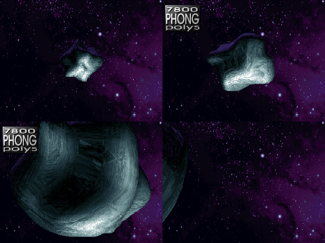

One lumpy sphere tumbling in front of a starfield: the clean case of the engine. The matrix and the vertex stage give each vertex two coordinate pairs (rotated
normal, unrotated normal); the filler interpolates both across the triangle with the packed `add/adc/adc` chain; per pixel it looks the pair up in a 128 x 128 map `fs`,
and the byte found there picks a row offset into a 256 x 256 picture `ds` where the other pair gives the column. Back faces are culled: 300 to 530 triangles are drawn
per frame. The background nebula is copied under the next frame as soon as the last one is copied out, so there is no clear.

The title's 7,800 is not a number the port can reproduce: no frame draws more than 533 triangles and the mesh has 1,024 (the record table has three more copies of the
sphere at other zoom factors, hidden and never shown by the script). Part 3 has a 21 step script.

**Exact vs approximated.** Exact in lock step (1,812 frames, every variable, frame buffer, picture, DAC), with a short masked list of scratch variables the port has no use
for (the sort's end pointer, temporaries, one dead store), documented in `tests/test_port3_run.mjs`.

## 5. Part 4: FIRE clouds, FRACTAL scape, checker floor

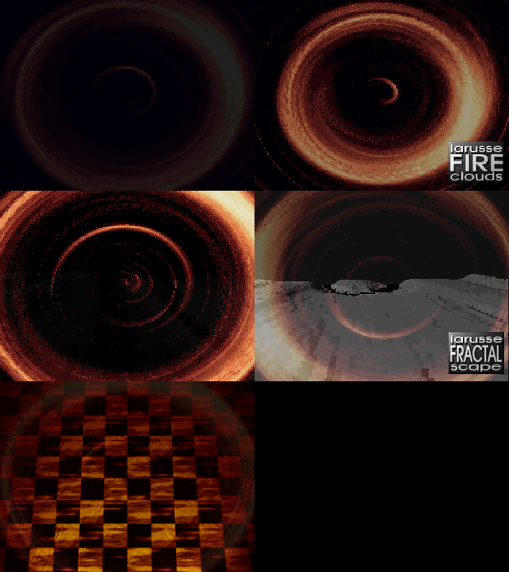

No 3D engine; 7,443 ticks, three layers sharing every byte of the screen.

**Two layers in one byte, and a computed palette.** The high nibble of a pixel is the fire's intensity (0..14), the low nibble a second layer (landscape or picture,
0..15). The palette is the 16 x 16 table of all combinations, computed:

```js
// part4.js mixPalette: 720 DAC bytes = 15 fire levels x 16 layer colours x RGB
v = rampA[p1[lo*3 + c]] + rampB[p2[hi*3 + c]];  out = v > 63 ? 63 : v;
```

`p1` is 16 RGB colours for the second layer, `p2` 16 for the fire, `rampA`/`rampB` the two ramps of part 1 (here the slope is `step >> 4`; part 2's identical routine does not
divide). To dissolve the fire into another look, or the landscape into the checker, the demo moves no pixel: it changes two ramps and uploads 720 palette bytes (the
label's own 16 colours, 0xf0..0xff, sit outside the table).

**The fire.** A 160 x 200 buffer of intensities. A *warp field* in the data (16,384 pairs of 16 bit offsets) says for each pair of pixels where to look in a 64 KB
texture; the whole animation is **one number**, the shift added to every offset (a sine of a running angle plus a steady drift):

```js
shiftFor(sine, angle, drift) { return (((sine[(angle & 0xffe) >> 1] + drift) | 0) >> 8) & 0xffff; }
// per pixel:  fire[i] = blend[ fire[i] ][ map[ warp[i] + shift ] ]
// blend[old][m] = min(0x70, (m*k + old*(256-k) + 63) >> 8),  k = 0x18
```

`blend` makes a pixel move k/256 = 9 % of the way from its old value to the texture value (an exponential smoothing by lookup). The fire buffer is read and written, so
it is a feedback system and its look depends on how many frames were drawn; the pass is skipped when the shift did not change. The texture is first rescaled
(`m = min(0x7f, m*7/4)`, `squashMap`).

**Composing.** The 160 wide fire becomes 320 pixels: each value doubled in width, a 4 x 4 ordered dither added (bytes 7, 0, 4, 1 in `edx`, rotated one byte per row), the high
nibble kept, the back buffer's low nibble added; four pixels per iteration (asm 15). Rows 148..191 go through a 44 row staging buffer so the label (a 70 x 44 sprite)
can slide in from the right edge.

**The landscape** is not 3D: two 256 x 256 byte arrays (heights and colours). Rows are drawn far to near; row `d` is map row `tbl[row]*16 + scroll`, the steps widening with
distance. Per column the map is sampled in 16.16 with linear interpolation (`imul` then `shrd ax,dx,7`), the height is multiplied by `0xaaaa/d` and subtracted from the
row's baseline `0x8000/d + 0x48`. A per column memory `ycol` holds the highest point drawn so far, and only the strip between the old and the new top is painted, so hidden
terrain costs nothing (classic voxel space occlusion; one division per row, two multiplies per column). `ycol` starts at 100 and is not cleared between frames.

**The checker floor** is an IFF ILBM picture (Deluxe Paint) in the block: the routine at `0x15f3` finds the `CMAP` and `BODY` chunks, shifts the 768 palette bytes to 6 bits and
unpacks ByteRun1 straight into the back buffer.

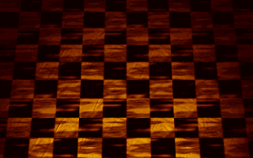

(Decoded for this write-up from the unpacked block 4 with a short ByteRun1 script; the palette is the file's CMAP, 768 bytes with values up to 255, shown as stored.)

The script is eight comparisons of one counter in the main loop (`0x1e19..0x1f81`), each followed by a few stores: fire over the previous screen to tick 1400, label
"FIRE clouds" in and out, a landscape grows out of the fire (palette 1 = terrain), "FRACTAL scape", the landscape fades, the checker floor goes under the fire.

**Exact vs approximated.** Exact in the same sense: 160 routine checks at 8 moments plus a lock step of 3,720 frames (`tests/test_port4.mjs`, `test_port4_run.mjs`).
Two initial states are inherited, not computed: the back buffer starts as a copy of the card (the previous part's last picture) and the first 16 colours of `p1` are read
back from the DAC; the page gets them by running the previous port to its end. The port runs at 33 pictures/s during the fire and 9 during the terrain in headless Chrome
on a software renderer (`docs/PORT4.md`).

## 6. Part 5: ENV mapping, BUMP glow

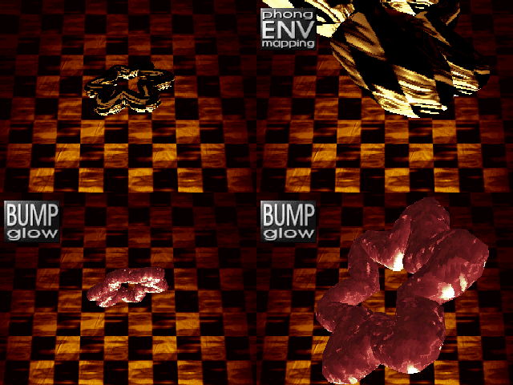

A thick tube folded like a worm, over the checker floor of part 4 (its low nibbles are kept as the background layer; the objects use colours 16..255). Two fills: for
about the first 1,500 ticks ("ENV mapping") the worm is covered by the plain texture fill (the golden streaked skin); from about tick 1,700, the red "BUMP glow", only
by the lookup fill whose row table the timer rebuilds every tick:

```js
// part5.js rebuildRows(dx): 0x3199, called from the timer
let bx = u16(-u16(dx * 8));
for (k = 0; k < 16; k++) { r[k] = bx >> 8; bx = u16(bx + dx); }   // r[k] = ((k - 8) * dx) >> 8
rows[16*i + j] = (r[i] << 8) | r[j];                              // every pair of entries
// dx = ((sin(angle) >> 4) * 3) >> 4, angle moves by a script set speed
```

The table is a brightness ramp used on both axes, so the lit sphere in the lookup picture swells and shrinks: that is the glow. At the end the high nibbles are filled with
part 6's first picture and the 16 x 16 palette is cross faded between two 16 colour palettes (part 4's `mixPalette`): the checker dissolves into the blue background of the
next part without a pixel drawn, paced by 64 retraces.

**Exact vs approximated.** Lock step over 2,253 frames, plus polygon by polygon (`--poly`), plus the end fade at its first and last step. `--poly` is what found the `shld 10`
and the `cwd` bugs (asm 18, 19).

## 7. Part 6: shadow, material morph, metal

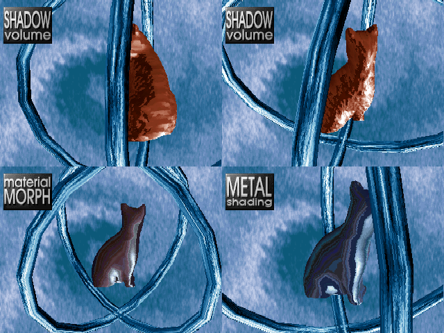

A cat in front of two crossed rings (blue tubes: the same engine drawn with focal length 3,500 so a 256 vertex ring fills the screen) and a blue picture. Same fillers and a
wobbling row table (here at `cs:0x10`) as part 5, `neg edx` in the vertex stage (mirrors the lighting coordinates), sort from bit 20.

* **Lights that follow the view** (`0x2f05`): the 256 wide lookup strip is repainted every frame in its right half. Each pixel fades by 0x10 (two pixels at once:
  `(ax - 0x1010) & 0x3f3f`) and the pattern pixel is added; the pattern is 64 x 64, each pixel doubled both ways, and one of 32 is chosen by the camera angle,
  `(-angle & 0x3fff) >> 9`.
* **Material morph is a palette fade.** Every tick the timer uploads colours 16..207: `clamp(rampA[paletteA[i]] + rampB[paletteB[i]])`, `paletteB` a second palette stored in the block; the
  ramps come from a fade position the script moves. The cat goes from brown to steel without any polygon changing.
* End: the DAC is read back and faded to black in 37 steps (`colour*bx >> 8`, `bx = 256, 249, ...`), one per retrace. A mouse driver could change the camera selectors
  (`int 33h`); without a driver that code is not taken, and the port leaves it out.

Lock step: 2,001 frames plus the fade out. The face list of this copy (0x3200) and the vertex arrays overlap the frame buffer's tail (64 KB at one segment, arrays 0xff00
later): the port keeps one memory image for that reason.

## 8. Part 7: multiple light sources

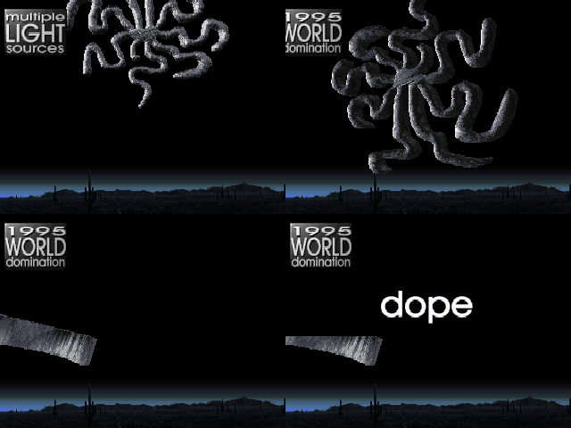

An eight armed star (1,446 vertices, flat: depth only +-534 against +-8191 in the plane) in front of a desert horizon; the camera finally flies into it until one arm fills the
screen, ending on a strip of picture with the word "dope". Its colours come from a 256 x 256 lookup picture rebuilt every frame (`0x3189`): copy a 64 KB background (`rep movsd`),
then add five 128 x 128 blob sprites with plain 32 bit `add`s, four pixels at a time, each at a position from the sine table at a different multiple of the tick counter:

```js
// part7.js, the add at 0x3146: 128 rows of 32 dwords, rows 256 apart
sum = (buf32 + blob32) | 0;   // bytes carry into each other; the blobs are dark enough that they never overflow
// positions: x = sin(t), sin(8t), sin(4t), sin(2t), sin(sin(3t)/8) against the matching cosine
```

The star's surface normals look up *this* picture, so highlights swim over the metal with nothing on the object changing. The script is 7 steps and 2,100 ticks, then a
128 x 64 strip is copied to the screen and the part idles for 350 ticks before the fade. The polygon routine also holds the plain texture mapper; no polygon of this part
takes it, so it was not ported. Between the polygon code and the data the author left a message (`HELLO LAMER !!! HAVING NICE TIME WITH MY CODE ???`, and a note that nobody should
say it is not optimized: "WHY OPTIMIZE ANYTHING FOR PENTIUM 100 MHZ?").

Lock step: 1,053 frames plus the final strip and the 350 tick wait.

## 9. What is exact, what is not

* **Part 1**: transcoded from the unpacked block, 11 of 15 reference frames from DOSBox-X identical, the other four 8 pixels off (last picture row).
* **Parts 2 to 7**: ports of the machine code, checked against **the original's own code run in an x86 interpreter with a VGA/DAC model** (`tools/vm/`), not against DOSBox:
  per frame, in lock step, comparing every variable the part owns, the intermediate buffers, the DAC and the picture. The interpreter is itself checked instruction by
  instruction against Unicorn and found real bugs (`shld imm8`, rotate flags, `imul` overflow flags, string instruction pointers). The README says explicitly that the original
  is **not** pixel compared against DOSBox for these parts, because it is not deterministic in the counter (the credit band differed between two DOSBox runs).
* **The lock step owns the timer**: the original's interrupt is held back and delivered k = 1, 2, 3, 2 ... ticks at a time between frames, so a frame is never interrupted.
  A real machine's interrupt fires mid frame, so what a frame shows depends on the machine's speed; the port is allowed to choose its own frame rate.
* **Timing on the page is measured, not derived**: the page drives each port at `TICK_HZ = 70.086` from the audio clock; each script step ends on the first frame after its tick
  count, so a part's length depends on how fast the machine drew; the lengths in `parts.json` come from DOSBox-X snapshots, and each port is given its part's length and spreads
  the difference over its steps (`slackFor`). A step may therefore end a few ticks off the original's on a given run.
* **Sound is approximated**: libopenmpt's rendering (8 tap sinc) stands in for the GUS replay routine; the pictures do not depend on it.
* **Seeking** in parts 2 to 7 restarts the part's port and fast forwards it; the screens that parts 4, 5, 6 inherit are computed by running the previous port to its end.
