# The effects, and the 3D models

What each part of DOPE shows, how it is made, and the seven meshes the 3D parts draw.  Everything
here was read out of the demo's own data and checked against the ports (`PORTING.md`); pictures are
drawn by the ports, models by `tools/models.mjs` straight from the blocks.  Mentions of what a
shape "is" (a cat, an octopus) are my reading of the render, not something the demo says.

## The parts

| part | length | labels on screen | the 3D object | the trick |
|------|-------:|------------------|---------------|-----------|
| 1 | 39 s | the COMPLEX logo | none | a window onto a 1344 line picture, palette from two ramps |
| 2 | 117 s | "phong BLUR motion", credits | a slab with a hole (250 vertices), a double ring like a letter C (432) | the screen fed back into itself, 81 % old picture |
| 3 | 52 s | "7800 PHONG polys" | a lumpy sphere (514) | phong by two table lookups per pixel |
| 4 | 106 s | "FIRE clouds", "FRACTAL scape" | none | fire by warping a buffer into itself, a voxel landscape, two pictures in one byte |
| 5 | 65 s | "phong ENV mapping", "BUMP glow" | a tube folded like a worm (432) | a lighting table that breathes; the checker floor of part 4 kept underneath |
| 6 | 58 s | "SHADOW volume", "material MORPH", "METAL shading" | a cat (352), two crossed rings (256) | lights that follow the camera; the palette cross-fades every tick |
| 7 | 36 s | "multiple LIGHT sources", "1995 WORLD domination" | an eight armed star (1446) | five moving blobs painted into the lookup table every frame |

(Lengths are the measured ones, `web/data/parts.json`.)

### Part 1: the logo

No polygons.  The picture is a strip of 1024 pixel wide rows, and the screen is a 320 pixel window onto
it: the scroll is one number written to the card's start-address and panning registers, the fade is
64 colours recomputed from two ramps.  `README.md`, section "Part 1".

### Part 2: phong BLUR motion

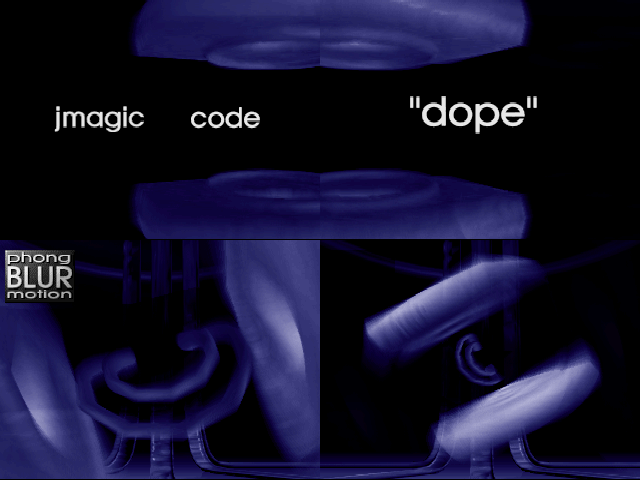

A credits sequence on top of two soft shapes.  The credit text is not a font: it is four pre-shaded
pictures (32 rows of 320 bytes each) in the data, loaded one after the other into a band buffer.  The polygons
are drawn on the band, and then every pixel of the screen is replaced by a table lookup of
(its previous value, the band's value): the screen is 81 % what it was and 19 % what is new.  That
is the blur of the title; objects leave a trail and the text melts in.  The lighting itself is a 128 x 128
ramp whose slope the script changes 118 times, so the sheen slides over the surfaces.  The second object (the C) is filled with the plain texture fill, the first only with the lookup fill; the palette
fades in from black over 64 ticks and the part ends on a white screen.  `PORT2.md`.

### Part 3: 7800 PHONG polys

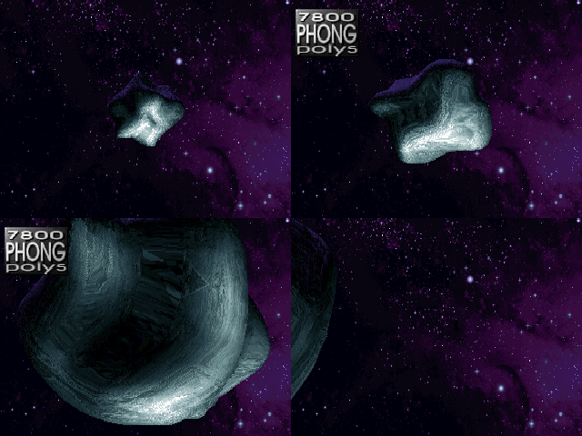

One lumpy sphere, turning against a starfield.  The shading is "phong" in the cheap sense used throughout:
each vertex carries its surface direction; the fill interpolates two such directions across the triangle and
looks the colour up in a table, so the highlights are smooth although the object has only 1,024 triangles.
Back faces are culled: between 300 and 530 triangles are drawn per frame.  The title's 7,800 is not a count I
can reproduce: no frame draws more than 533, and the mesh has 1,024.  The record table holds three more
copies of the sphere at other zoom factors, hidden and never shown by the script.  `PORT3.md`.

### Part 4: FIRE clouds, FRACTAL scape

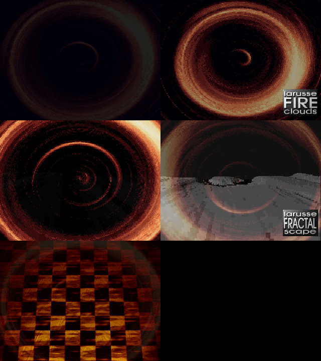

No 3D engine.  Three layers share every byte of the screen (the high nibble is the fire's intensity, the
low nibble is a landscape or picture), and the palette is the 16 x 16 table of all combinations, computed
from two 16 colour palettes through two cross-fading ramps.  Changing the look of the fire, or dissolving
it into the landscape, moves no pixel: it uploads 720 bytes of palette.  The fire is a buffer that
is warped into itself by a rotation field each frame; the landscape is a height field drawn column by column;
the last stage is a picture of a checker floor.  `PORT4.md`.

### Part 5: phong ENV mapping, BUMP glow

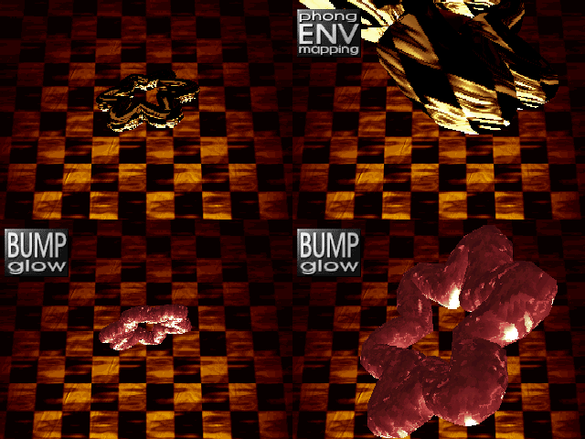

The checker floor is part 4's last picture (its low nibbles kept as the background), and the worm moves over it.
Two fills are used.  For the first 1,500 ticks or so (the "ENV mapping" frames) the worm is covered, wholly or in
part, by the plain texture fill (the golden streaked skin); from about tick 1,700 on, in the red "BUMP glow" stage,
it is drawn only by the lookup fill, whose row table the timer rebuilds
every tick from a sine: the table is a brightness ramp used on both axes, so the highlights swell and
shrink, which is the glow.  At the end the high nibbles are filled with part 6's first picture and the palette
is cross-faded: the checker dissolves into the blue background of the next part without any pixel being drawn.
`PORT5.md`.

### Part 6: SHADOW volume, material MORPH, METAL shading

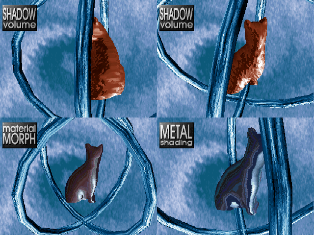

A cat in front of two huge crossed rings (the blue tubes: the same engine, drawn with a focal length of
3,500 so the 256 vertex ring fills the screen) and a blue picture.  The "material morph" is a palette fade: the timer cross-fades
colours 16 to 207 between two stored palettes every tick, so the cat's skin changes from brown to steel
without a single polygon changing; the lookup table the fill reads is a 128 x 128 strip that is repainted
each frame: the old picture fades by 16 per pixel and a 64 x 64 pattern, picked by the camera's angle, is
added, so lights follow the view.  `PORT6.md`.

### Part 7: multiple LIGHT sources, 1995 WORLD domination

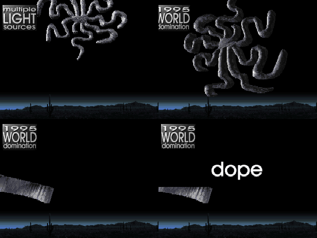

The octopus (an eight armed star of 1,446 vertices, flat: its depth is only +-534 against +-8191 in the plane)
in front of a desert horizon.  Its colours come from a 256 x 256 lookup picture that is rebuilt every frame: a
background plus five 128 x 128 blobs added with a plain 32 bit `add`, each following its own Lissajous path
(`sin t`, `sin 8t` ...), so the highlights swim over the metal by themselves: the "multiple light sources".
The camera then flies into the figure until a single arm fills the screen, and the part ends on a strip of
picture with the word "dope".  `PORT7.md`.

## The models

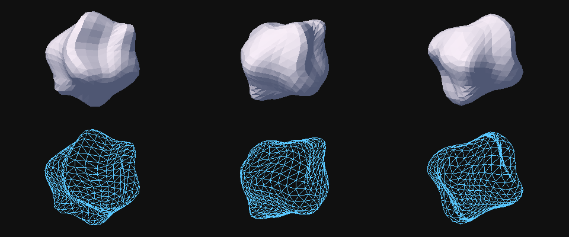

Above: the sphere of part 3, three views, shaded and as a wireframe, drawn from the demo's data by
`tools/models.mjs`.

| name | part | vertices | faces | edges | Euler number | what it looks like |
|------|-----:|---------:|------:|------:|-------------:|--------------------|
| `part2_ring` | 2 | 250 | 500 | 750 | 0 | a pentagonal slab with a pentagonal hole, an oval groove on its face |
| `part2_knot` | 2 | 432 | 864 | 1296 | 0 | a tube bent into a double C, 12 sided, 36 steps |
| `part3_rock` | 3 | 514 | 1024 | 1536 | 2 | a lumpy sphere |
| `part5_worm` | 5 | 432 | 864 | 1296 | 0 | a thick tube folded over itself, 12 sided, 36 steps |
| `part6_open` | 6 | 352 | 671 | 1022 | 1 | a cat; an open surface (it has a hole underneath) |
| `part6_cube` | 6 | 256 | 512 | 768 | 0 | two crossed rings, 16 sided, 16 steps |
| `part7_snakes` | 7 | 1446 | 2888 | 4332 | 2 | an eight armed star, flat |

The Euler number `V - E + F` tells what a mesh is topologically: 2 is a sphere (part 3's rock, the octopus,
closed at the arms' ends), 0 a torus (the rings and tubes: sweeps of a 12 or 16 sided section along a closed
path, which is why 432 = 12 x 36 and 256 = 16 x 16 and why the face index deltas in the data are the same
`-12, -13` / `1, -12` pairs 19 times in a row), and 1 a surface with a boundary (the cat).  The tube meshes
of parts 2 and 5 have identical topology and different shape: the author ran one generator with two paths.

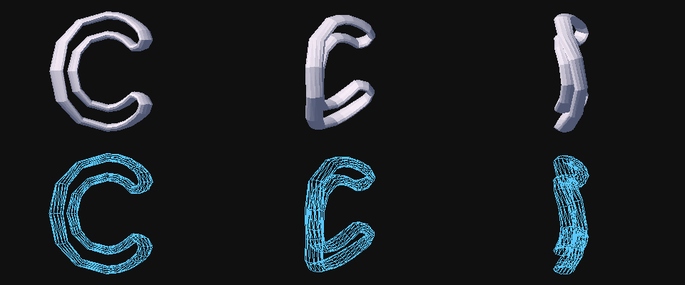

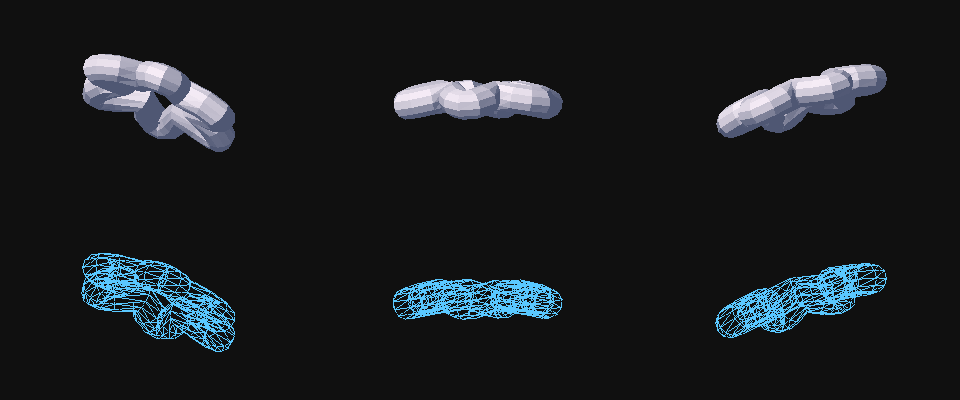

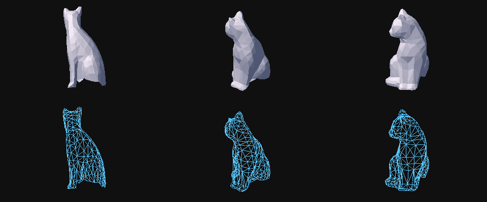

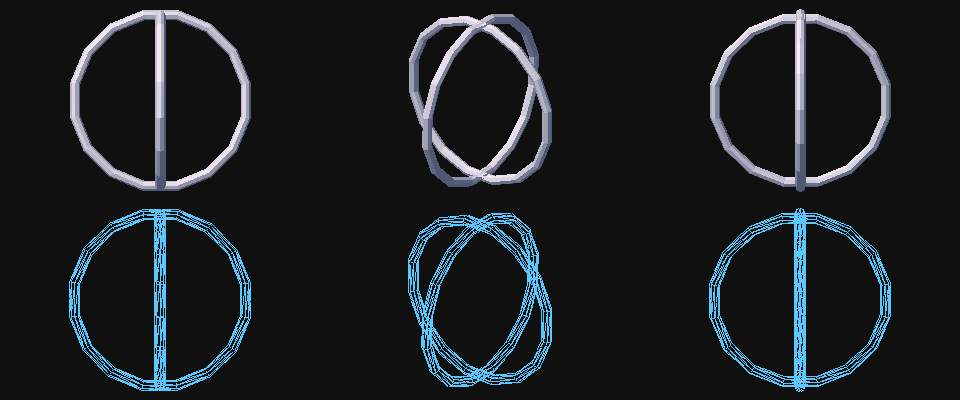

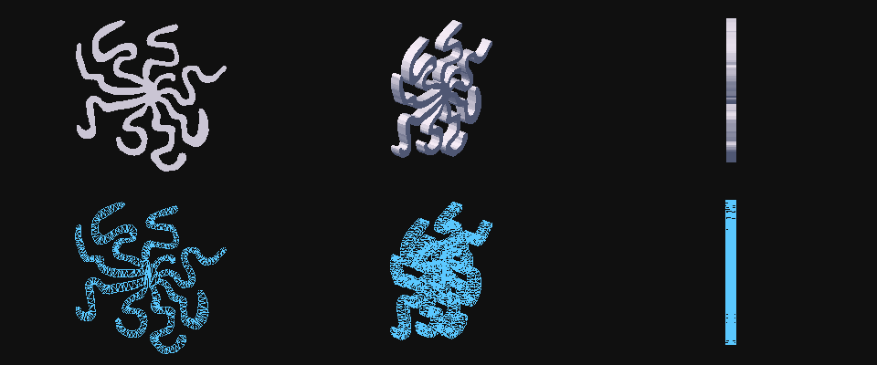

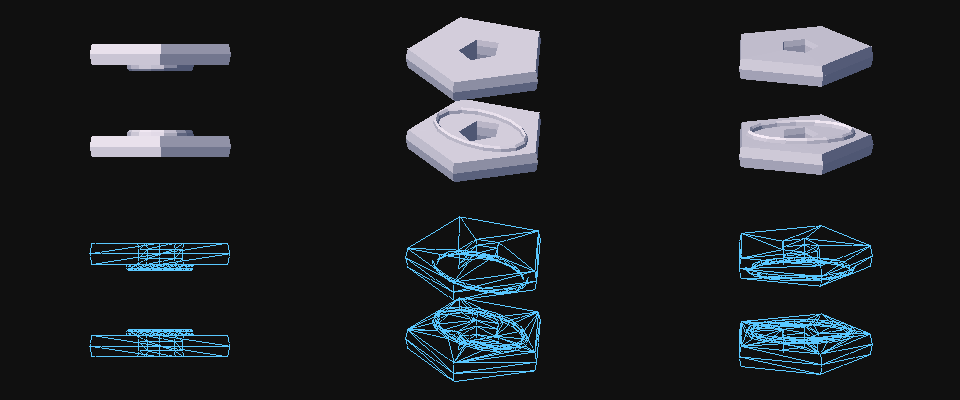

### How a model is stored

One segment per mesh, a 16 byte header of word offsets and then four arrays:

```
+0   vertex count            +2   face count
+4   offset of the vertices  +6   offset of the faces
+8   offset of the normals   +10  offset of the texture coordinates
vertices   3 x int16 each (x, y, z), within +-8191: a 14 bit signed range, centred on the origin
faces      8 bytes: an attribute word, then three vertex numbers, each times 4
normals    3 x int16 each, every one of the same length, 27,559 (0x6BA7): unit vectors, scaled
texcoords  2 x int16 each (u, v), 0x4000..0x7FFF in the data (used by parts 2, 5 and 6; parts 3 and 7 compute
           theirs from the normals)
```

* The faces carry no material of their own: the attribute word is 0 in all 7 meshes.  The material
  (which of four lookup tables or textures a triangle is filled with) comes from the object's record, from the
  two bytes of a selector word that are added to the low bits of the face's vertex numbers.
* Faces are wound so that the sign of a 16 bit cross product of two screen edges says whether they face the
  viewer; a flag in the object record flips the test for objects whose faces point inwards.
* A mesh is 8 to 46 KB: the octopus is `1446 x (6 + 6 + 4) + 2888 x 8` bytes.
* Parts 2 and 5 each have a 432 vertex tube; they are different meshes with the same topology and the
  same size, 13,840 bytes.

### The object record

The scene is a table of 0x3A byte records, the first one the camera (segment `0xFFFF`), ended by a zero
segment word:

```
+0x00 mesh segment       +0x02 hidden (non zero: skipped)    +0x04 focal length (zoom)
+0x06 position x,y,z     3 x int32 (+0x0A, +0x0E), added to the vertices after a shift left by 8
+0x12 velocity x,y,z     3 x int32, added to the position every tick
+0x1E angles a,b,c       3 x int16, 0..0xFFFF for a turn (the engine uses angle >> 4, 4096 steps)
+0x24 angular speeds     3 x int16, added to the angles every tick
+0x2A selector           two bytes added to the material bits
+0x2C cull flag          which side of a triangle is the front
+0x2E vertex offset      3 x int32, added to every vertex before it is rotated
```

For the camera only the position and angles count: the engine adds them to each object's.  The timer
interrupt does the moving (angles += angular speeds, positions += velocities, for every record), and the
script, a straight line of `mov [var],imm` and `call run` (21 to 153 steps per part), sets speeds and
positions: that is the whole choreography.

## Numbers per part

| part | visible faces per frame (max / mean) | objects shown at once | script steps |
|------|-------------------------------------:|----------------------:|-------------:|
| 2 | 891 / 571 | 2 | 153 |
| 3 | 533 / 399 | 1 | 21 |
| 5 | 463 / 412 | 1 | 28 |
| 6 | 661 / 601 | 2 | 16 |
| 7 | 1492 / 1440 | 1 | 7 |

(Counted by the port, sampled every 20 ticks, after back face culling.)  The 386 or 486 that this ran on
did that, at a frame rate that depended on the machine, in a few thousand lines of hand written assembly.
